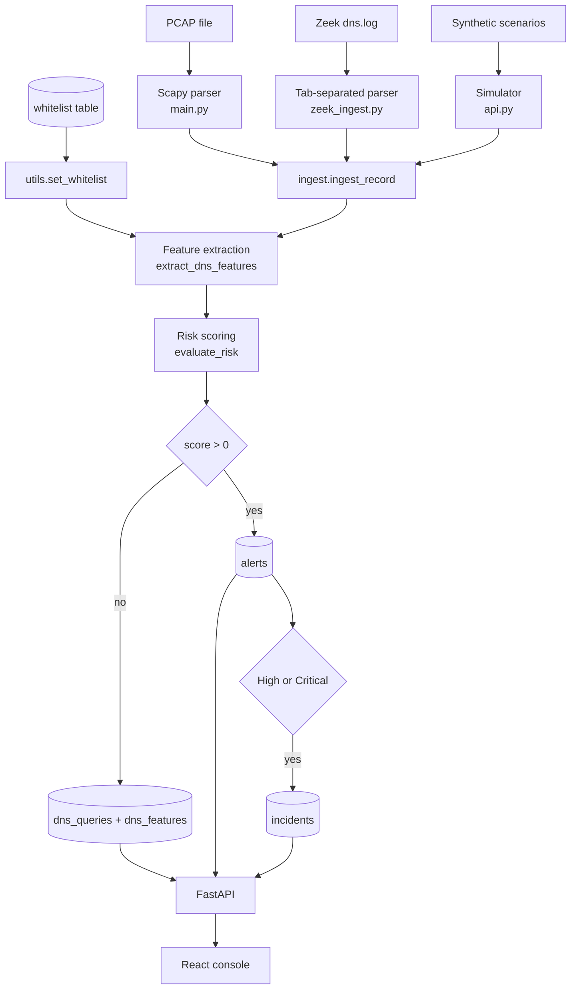

# DNS Tunneling Detection & Incident Response Platform

A SOC-style detection pipeline for covert DNS tunneling, built as a full-stack system: packet and log ingestion, a feature-extraction scoring engine, PostgreSQL persistence, a FastAPI service, and a React triage console.

DNS is the one protocol almost every network allows out through the firewall. That makes port 53 a reliable fallback channel for command-and-control and data exfiltration when HTTP is blocked — Iodine, dnscat2, dnstt, and Cobalt Strike's DNS beacon all exploit it. The traffic itself looks like ordinary resolution, so a signature-only rule set has very little to match on. This project scores the *shape* of each query instead.

---

## Contents

- [How it works](#how-it-works)
- [Detection methodology](#detection-methodology)
- [Detection engine output](#detection-engine-output)
- [Project layout](#project-layout)
- [Setup](#setup)
- [Running the platform](#running-the-platform)
- [API reference](#api-reference)
- [Dashboard](#dashboard)
- [Limitations and known gaps](#limitations-and-known-gaps)
- [Roadmap](#roadmap)

---

## How it works



Every ingestion source calls the same `ingest_record()` function, so a query is scored identically no matter how it entered the system. That was the main structural change from the original design, which had the insert-and-score block duplicated across three files.

The `dns_queries` table carries a unique index on `(timestamp, source_ip, domain, query_type)`. Re-importing the same log file is therefore idempotent — the second run inserts nothing and reports the duplicates as skipped rather than doubling every count in the dashboard.

---

## Detection methodology

The engine in `backend/utils.py` computes structural, statistical and lexical features per query, then scores them between 0 and 100.

### The design constraint: every signal needs corroboration

A single lexical statistic is almost never evidence on its own. Three examples that shaped the current implementation:

**High entropy is normal.** A CDN hostname and a base32 exfiltration chunk look equally random. Raw Shannon entropy is also length-dependent — a 10-character label can never exceed `log₂(10) = 3.32`, so the usual fixed threshold of 3.75 silently exempts every short label while flagging long legitimate ones.

The engine instead reports entropy as a *ratio* of the maximum achievable for that label length:

```
H(X) = -Σ p(xᵢ) · log₂ p(xᵢ)
ratio = H(X) / log₂(min(len, 37))
```

A ratio above 0.92 means the label is as random as a string that length can be. That is comparable across label sizes and is what the scoring actually uses.

**Hex-looking is normal.** The characters `a`–`f` appear in ordinary words. A "hex ratio" test alone fires on `deadbeef` and on `cafe`, so the hex signal requires the label to be at least 24 characters long before it contributes, at which point an accidental all-hex string has probability around `(16/36)²⁴` — roughly one in fifty million.

**Base32-looking is essentially universal.** This was the most serious bug in the earlier version. Its `base32_ratio` measured the fraction of characters *inside* the RFC 4648 alphabet `a–z2–7`, which covers every lowercase letter and most digits. Every hostname scored 1.00:

| Hostname | old `base32_ratio` | true signal |
|---|---|---|
| `www.google.com` | 1.00 | none |
| `login.microsoftonline.com` | 1.00 | none |
| `api.github.com` | 1.00 | none |
| `4g6d8e0f1g2h3j4k5l6m7n8p9q0r1s2t.tunnel-endpoint.biz` | 0.78 | base32-shaped |

The metric was measuring little more than "contains no digit 0, 1, 8 or 9". It now measures the *foreign* character ratio (fraction outside the alphabet), requires an actual RFC 4648 decode to succeed, and checks that the decoded bytes are printable. A real base32 payload decodes to structured bytes; a random hostname that happens to sit inside the alphabet decodes to noise.

### Signal weights

| Signal | Condition | Points |
|---|---|---|
| Label length | ≥ 50 chars / ≥ 30 chars / extended | 25 / 15 / 8 |
| Entropy ratio | ≥ 0.92 / ≥ 0.80 of ceiling | 30 / 18 |
| Hex profile | ≥ 98% hex and ≥ 24 chars / ≥ 90% hex | 25 / 12 |
| Base32 decode | decodes, ≤ 2% foreign chars, ≥ 16 chars | 22 (printable) / 14 (binary) |
| Consonant run | ≥ 8 / ≥ 5 with bulk | 12 / 6 |
| Vowel deficit | ≤ 12% vowels on a ≥ 16 char payload | 8 |
| Record type | NULL / TXT with bulk / long CNAME | 20 / 16 / 12 |
| Tool signature | `dnscat` / `iodine`, `dnstt`, `dns2tcp` | 30 / 22 |
| Whitelist | any match | short-circuits to 0 |

Severity bands: **Low** ≤ 29, **Medium** 30–49, **High** 50–79, **Critical** ≥ 80. Alerts at High and above automatically open an incident.

Published service records — `_dmarc`, `_domainkey`, `_acme-challenge` and the rest of the RFC 8552 set — carry cryptographic selectors by design. Their entropy and structural weights are reduced rather than suppressed, because a tunnel can be pointed at any name.

---

## Detection engine output

Scoring the bundled sample corpus. The benign set includes the hard cases deliberately: a SHA-256 hostname, a DKIM selector, and a long AWS service name.

```
BENIGN
    0  Low       www.google.com
    0  Low       login.microsoftonline.com
    0  Low       api.github.com
    0  Low       outlook.office365.com
    0  Low       cdn.jsdelivr.net
    8  Low       static-assets.prod.us-east-1.mycompany.com
   26  Low       a1b2c3d4e5f6.internal.corp.example.com
   37  Medium    e3b0c442…7852b855.sha256.digicert.com   ← certificate hash
    0  Low       _dmarc.google.com
   19  Low       selector1._domainkey.outlook.com
   29  Low       analytics-prod-usw2.internal.aws.example.com

MALICIOUS
   64  High      7365637265742d646174612d64756d702d3031.c2-command.org
   60  High      61646d696e5f70617373776f72645f68617368.c2-command.org
   66  High      dnscat.0102030405060708deadbeef.malicious-tunnel.com
   84  Critical  dnscat.fa73b92c4e1198501234abcd.malicious-tunnel.com
   53  High      4g6d8e0f1g2h3j4k5l6m7n8p9q0r1s2t.tunnel-endpoint.biz
   56  High      f9e8d7c6b5a43210f9e8d7c6b5a43210f9e8d7c6b5a43210.exfil-dns.net
   64  High      783261623938633736643534653332663161306239386337.exfil-dns.net
   91  Critical  mjqwq3dmnfsdgnbwmy2dsnzyhjrgk4tf.evil-c2.net
```

Worst benign score 37, weakest true tunnel 53. The only benign query above the Medium threshold is a certificate-transparency hash, which is a legitimate hostname shape and cannot be told apart from a hex payload without context — that is what the whitelist exists for.

**This is a hand-built sample corpus, not an evaluation set.** See [Limitations](#limitations-and-known-gaps).

---

## Project layout

```
DNS_Tunneling_HCL/
├── backend/
│   ├── api.py            FastAPI routes, error handling, simulation, export
│   ├── database.py       Schema DDL, migrations, de-duplication index
│   ├── ingest.py         Shared query → features → alert → incident path
│   ├── main.py           Scapy PCAP parser
│   ├── zeek_ingest.py    Zeek dns.log parser
│   ├── utils.py          Feature extraction and risk scoring
│   ├── config.py         Database configuration from environment
│   └── requirements.txt
├── frontend/
│   └── src/
│       ├── App.js                     State, routing between views, refresh loop
│       ├── App.css                    Operator-console theme
│       ├── services/api.js            Axios client and offline fallback data
│       └── components/
│           ├── Header.jsx             Status, refresh, actions, export menu
│           ├── MetricsOverview.jsx    Five-metric summary strip
│           ├── ThreatAnalytics.jsx    Severity mix, timeline, top targets
│           ├── AlertsTable.jsx        Filterable triage table
│           ├── ForensicDrawer.jsx     Per-alert deep inspection
│           ├── IncidentsView.jsx      Escalated incident queue
│           ├── WhitelistView.jsx      Rule management with live scoring preview
│           ├── TelemetryStreamModal.jsx  Polling raw query stream
│           └── TrafficSimulatorModal.jsx Scenario injection and file import
├── datasets/suspicious/test_traffic.pcap
├── zeek/logs/dns.log
├── start_windows.ps1
└── README.md
```

---

## Setup

### Requirements

Python 3.9+, Node.js 18+, PostgreSQL 13+.

### 1. Database

Create a database and a role that owns it:

```sql
CREATE DATABASE dns_tunneling_db;
CREATE USER db_user WITH ENCRYPTED PASSWORD 'change-me';
GRANT ALL PRIVILEGES ON DATABASE dns_tunneling_db TO db_user;
```

### 2. Backend

```bash
cd backend
python -m venv .venv
# Windows
.venv\Scripts\activate
# macOS / Linux
source .venv/bin/activate

pip install -r requirements.txt
```

Copy `.env.example` to `.env` and set the credentials:

```env
DB_NAME=dns_tunneling_db
DB_USER=db_user
DB_PASSWORD=change-me
DB_HOST=localhost
DB_PORT=5432

# Optional — comma-separated origins allowed to call the API
ALLOWED_ORIGINS=http://localhost:3000
```

Create the schema:

```bash
python database.py
```

This is safe to re-run. It creates missing tables, applies column migrations, removes duplicate query rows left by earlier non-idempotent imports, and installs the unique index.

### 3. Frontend

```bash
cd frontend
npm install
```

To point the dashboard at a non-default API host, create `frontend/.env`:

```env
REACT_APP_API_URL=http://127.0.0.1:8000
```

---

## Running the platform

### Windows, one command

```powershell
.\start_windows.ps1
```

This initialises the schema, starts the API, and starts the dev server.

### Manually

```bash
# terminal 1
cd backend && python api.py

# terminal 2
cd frontend && npm start
```

| Service | URL |
|---|---|
| Dashboard | http://localhost:3000 |
| API | http://127.0.0.1:8000 |
| OpenAPI docs | http://127.0.0.1:8000/docs |

### Loading data

Three routes, all writing through the same pipeline:

```bash
cd backend

# 1. Parse a packet capture (defaults to the bundled sample)
python main.py
python main.py /path/to/capture.pcap

# 2. Import Zeek telemetry (defaults to ../zeek/logs/dns.log)
python zeek_ingest.py
ZEEK_LOG_PATH=/var/log/zeek/dns.log python zeek_ingest.py
```

3. From the dashboard: **Simulate** → choose a scenario, or use the file-import buttons.

If PostgreSQL is unreachable, the dashboard falls back to a bundled sample data set and labels the connection state `Offline · sample data`. The status pill never claims to be live when it isn't.

---

## API reference

All endpoints return JSON. Failures carry a real HTTP status and an error body:

```json
{ "error": { "message": "Alert not found", "detail": "No alert with id 9999" } }
```

### Alerts

| Method | Path | Description |
|---|---|---|
| `GET` | `/api/alerts` | Paginated alert list. Filters: `severity`, `status`, `search`, `limit`, `offset`. Returns `total` for the current filter. |
| `GET` | `/api/alerts/{id}` | Full forensic detail, including linked incidents. `404` if absent. |
| `PUT` | `/api/alerts/{id}/status` | Update status and notes. Validates the status against the lifecycle enum and propagates to the linked incident. |

### Incidents

| Method | Path | Description |
|---|---|---|
| `GET` | `/api/incidents` | Incident queue, ordered by triage priority then recency. Filters: `status`, `severity`. |
| `PUT` | `/api/incidents/{id}` | Update status, assignee or notes. |

### Telemetry

| Method | Path | Description |
|---|---|---|
| `GET` | `/api/queries` | Most recent raw queries with features and verdicts. |
| `GET` | `/api/metrics` | Aggregate totals, severity breakdown, top domains, top source IPs, and hourly activity for the 15 most recent buckets. |
| `POST` | `/api/analyze` | Score a single hostname without persisting it. `?domain=…&query_type=…` |

### Ingestion and simulation

| Method | Path | Description |
|---|---|---|
| `POST` | `/api/simulate` | Inject a synthetic scenario: `all`, `base32_exfil`, `c2_beaconing`, `iodine_hex`, `benign`. |
| `POST` | `/api/ingest/zeek` | Import `zeek/logs/dns.log`. |
| `POST` | `/api/ingest/pcap` | Import the bundled PCAP. |

Ingestion responses report `inserted`, `skipped`, `alerts` and `incidents`, so duplicates are visible rather than silent.

### Whitelist

| Method | Path | Description |
|---|---|---|
| `GET` | `/api/whitelist` | All rules. |
| `POST` | `/api/whitelist` | Add a rule. Takes effect immediately — the in-memory rule cache is refreshed on write. |
| `DELETE` | `/api/whitelist/{pattern}` | Remove a rule. |

### Export

| Method | Path | Description |
|---|---|---|
| `GET` | `/api/export?format=csv` | Alert report as CSV. |
| `GET` | `/api/export?format=json` | Alert report as JSON, including all feature values. |

---

## Dashboard

The console has three views.

**Alerts** — five-metric summary, three charts, and the triage table. The table filters by severity and status, searches across domains, IPs and indicators, sorts on any column, and toggles between normal and compact row density. Changing a status is optimistic: the row updates immediately and rolls back if the write fails.

**Incidents** — the escalated queue, ordered by triage priority. Status can be changed inline; clicking an unassigned row takes ownership.

**Whitelist** — add and remove suppression rules. Typing a pattern scores it live through `/api/analyze`, so you can see what you are about to suppress before committing the rule.

The forensic drawer (click any alert) shows the full feature vector, a length-normalised entropy meter, decoded payload where one can be recovered, the triggered indicators, pivot links to VirusTotal / Shodan / AbuseIPDB, and the triage form.

Keyboard: `Ctrl`/`Cmd`+`K` focuses search, `Esc` closes the drawer or any modal.

---

## Limitations and known gaps

These are real and worth stating plainly.

**The evaluation corpus is synthetic.** `datasets/suspicious/test_traffic.pcap` is 1.6 KB and `zeek/logs/dns.log` holds 13 records. The malicious entries were written to exercise the detector, and several contain the tool names (`dnscat`, `tunnel`) that the signature rules look for. The scores above demonstrate that the engine behaves as designed; they are **not** a measurement of detection rate. No precision, recall, or false-positive rate can be quoted from this data, and the thresholds have not been calibrated against real traffic.

**There is no temporal analysis.** Detection is per-query. A tunnel sending one short query every 30 seconds is invisible here, because volume, periodicity and query-rate variance are never computed. This is the largest missing detection capability — dnscat2 in particular is designed to look quiet per-packet.

**No response-code or NXDOMAIN analysis.** Tunnels typically produce heavy NXDOMAIN and unusual answer patterns. The parsers do not currently read `rcode_name` or answer vectors.

**The apex split is a heuristic.** `extract_dns_features` assumes the last two labels are the registrable domain. That is wrong for multi-part public suffixes (`example.co.uk`, `shop.example.com.au`), where it will misattribute the subdomain. A public-suffix list would fix it.

**The whitelist matches suffixes only.** There is no wildcard or regex support; a rule for `example.com` covers every subdomain, which may be broader than an analyst intends.

**No authentication.** The API binds to `127.0.0.1` and assumes a trusted local operator. Do not expose it to a network as-is.

**Scapy is required for PCAP import.** If it is missing, the API still starts and only `/api/ingest/pcap` returns `503`.

---

## Roadmap

The gaps above suggest an order of work:

1. Capture a real corpus — dnscat2, iodine and dnstt against a local resolver, mixed with ordinary traffic from the same network — and build a confusion matrix. Every threshold in `evaluate_risk` should be tuned against it rather than by inspection.
2. Add a sliding-window aggregator: query rate per source/domain, inter-arrival variance, and ratio of NXDOMAIN responses. This is what catches beaconing.
3. Parse the answer section and response codes so the feature vector covers both directions of the tunnel.
4. Replace the two-label apex split with a public-suffix list.
5. Add authentication and per-analyst audit logging before this goes anywhere near a shared network.

---

## Notes

Built as an academic project on DNS tunnelling detection and incident response. The detector is deliberately explainable — every score is a sum of named, inspectable indicators rather than a black-box output, which is a requirement for anything an analyst has to defend in a report.

Third-party labels referenced for context: Iodine (T. N. Pappas), dnscat2 (Ron Bowes), dnstt.
